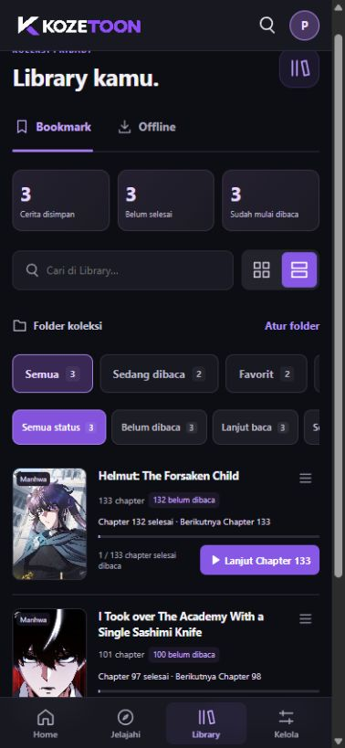
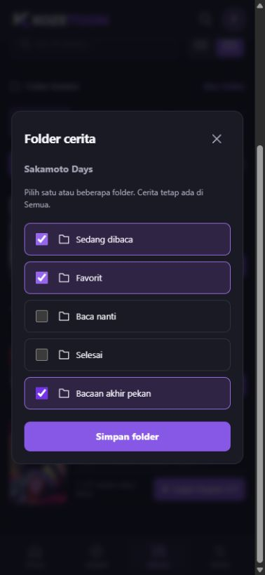
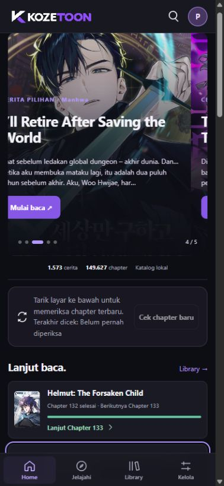
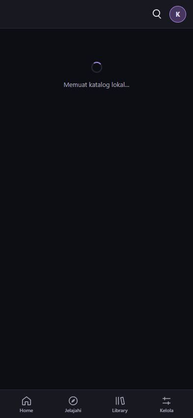
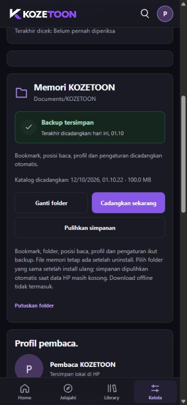

# KOZETOON 1.1.2

<!-- kozetoon-build:23 -->

Rilis stabil **1.1.2**, 12 Oktober 2026. Android 7.0 ke atas, ARM64;
x86_64 tersedia untuk emulator. Kode sumber tetap private. Kanal ini menyediakan
APK dan panduan pengguna.

**[Unduh APK terbaru](https://github.com/AtillaKuncoroDjati/kozetoon-releases/releases/download/v1.1.2/KOZETOON-1.1.2-local.apk)**

## Perubahan versi ini

- **Gambar pulih saat internet kembali.** Halaman yang gagal otomatis dicoba
  lagi ketika koneksi tersedia atau saat kembali ke reader. Gambar yang sudah
  tampil tetap dipertahankan. Maksimal dua permintaan berjalan bersama, dengan
  percobaan terbatas; tombol **Coba lagi** tetap tersedia untuk alamat yang gagal.
  Jika gambar di atas bacaan pulih dan tinggi halaman berubah, posisi yang sedang
  dibaca dijaga. Percobaan dihentikan setelah keluar dari chapter.
- **Lanjut baca lebih pintar.** Setelah chapter selesai, kartu di Home dan Library
  serta tombol pada detail menawarkan chapter berikutnya. Contoh: **Chapter 98
  selesai → Lanjut Chapter 99**. Jika chapter berikutnya belum siap, buka detail
  cerita; urutan chapter tidak dilompati. Jika sudah di chapter terbaru, tampil
  keterangan menunggu chapter baru. Bacaan yang belum selesai tetap melanjutkan
  halaman dan posisi terakhir.
- **Backup lebih jelas.** Kelola menampilkan **Terakhir dicadangkan** beserta tanggal
  dan jam. Perubahan yang belum tersalin dibedakan dari backup yang sudah berhasil.
  Kegagalan pribadi maupun katalog tetap ditampilkan setelah aplikasi dibuka ulang,
  dengan **Coba backup lagi**. Peringatan ringkas juga muncul di Home dan Library.
  Jika akses folder terputus, pilih **Hubungkan lagi**. Status berhasil hanya muncul
  setelah file selesai ditulis dan diperiksa.
- **Folder Library.** Tersedia **Sedang dibaca, Favorit, Baca nanti, Selesai**,
  serta folder buatan sendiri. Satu cerita dapat masuk beberapa folder. Pencarian,
  filter status baca dan tampilan grid/daftar tetap tersedia. Folder, nama dan
  pilihan cerita ikut dicadangkan ke memori lokal. Backup versi sebelumnya tetap
  dapat dipulihkan; perubahan folder yang lebih baru di HP dipertahankan saat merge.
- **Update lewat aplikasi.** Pengguna 1.1.0 dan 1.1.1 dapat menerima 1.1.2 melalui
  **Cek update → Unduh update → Pasang update**. Identitas aplikasi dan sertifikat
  dipertahankan. Tampilan hanya menyebut **1.1.2**.

Pembuka tiga kolom poster bergerak dengan logo K diam, nada **Universfield — Level Up**,
update favorit terjadwal, notifikasi poster, kontrol reader, download offline dan
backup katalog tetap tersedia. Pemeriksaan chapter tidak otomatis mengunduh gambar
offline; download gambar tetap melalui tombol **Download**.

## Cara memasang update

Untuk pengguna **1.1.0 atau 1.1.1**:

1. Buka **Kelola → Versi aplikasi → Cek update** dengan internet aktif.
2. Saat pembaruan **1.1.2** muncul, baca perubahan lalu pilih **Unduh update**.
3. Setelah pemeriksaan selesai, pilih **Pasang update** dan konfirmasi **Update/Pasang**
   pada pemasang Android. Berikan izin memasang dari KOZETOON jika Android memintanya.
4. **Jangan uninstall dahulu.** Bookmark, riwayat, profil, katalog dan file offline
   tetap berada dalam data aplikasi. Tidak ada reset database untuk pembaruan ini.

Jika baru saja menekan Cek update, tunggu sekitar satu menit sebelum mencoba lagi.
Pemeriksaan otomatis mempunyai jeda enam jam; tombol Cek update meminta pengecekan
manual. APK diperiksa ukuran, SHA-256, identitas aplikasi dan sertifikat sebelum
pemasang Android dibuka. Pemasangan tetap memerlukan pilihan pengguna.

Pengguna 1.0.7 yang masih menunjuk repository lama/private perlu memasang APK terbaru
secara manual satu kali dari tautan di atas. Setelah itu updater memakai kanal publik.
Sediakan sekitar 1 GB ruang kosong untuk katalog dan operasi backup.

## Mengikuti chapter favorit

1. Bookmark cerita yang ingin diikuti.
2. Buka **Kelola → Update & notifikasi** dan aktifkan **Update favorit di latar belakang**.
3. Aktifkan **Beri tahu saat ada chapter baru** dan berikan izin notifikasi Android.
4. Jika ingin membisukan satu cerita, buka **Library → menu cerita → Matikan notifikasi cerita**.

Pemberitahuan baru dibuat setelah daftar gambar chapter siap. Poster kecil
bersifat pelengkap; kegagalan memuat poster tidak menghalangi pemberitahuan.
Jika izin ditolak, aplikasi tetap bisa memperbarui favorit dan cerita tetap
terlihat di Update Library. Pengaturan dapat diubah kembali di Kelola.

Jadwal mengikuti Android, koneksi dan kondisi baterai. Penghemat baterai Xiaomi
atau pembatasan aktivitas latar belakang dapat menunda pekerjaan. Gunakan tombol
**Pengaturan baterai** jika perlu mengatur aktivitas KOZETOON. Tidak ada janji
notifikasi muncul tepat saat chapter diterbitkan. Force stop/Hentikan paksa
menghentikan pekerjaan sampai aplikasi dibuka lagi. Daftar favorit besar dan
chapter yang gagal disiapkan diproses bertahap, dengan percobaan berikutnya.

Mengaktifkan fitur atau mengaktifkan kembali notifikasi tidak membanjiri pembaca
dengan semua chapter lama. Penanda **chapter baru** di Library berbeda dari
notifikasi Android: membuka detail atau menghapus notifikasi tidak menghapus
status belum dibaca. Selesaikan chapter atau pilih **Tandai semua sebagai sudah dibaca**.

## Mengatur folder Library

1. Simpan cerita dengan **Bookmark**, lalu buka **Library**.
2. Ketuk ikon menu pada kartu cerita → **Atur folder cerita**.
3. Centang satu atau beberapa folder → **Simpan folder**.
4. Ketuk nama folder di baris **Folder koleksi** untuk melihat isinya. Geser baris
   tersebut ke kiri atau kanan untuk menemukan folder lainnya.
5. Pilih **Atur folder** untuk membuat folder sendiri atau mengubah nama folder pribadi.

Folder dikelola manual agar sesuai pilihan pembaca. Filter **Selesai dibaca** dihitung
dari progres baca, sedangkan folder **Selesai** berisi cerita yang kamu masukkan sendiri.
Menghapus folder tidak menghapus cerita, bookmark, riwayat atau download. Menghapus
bookmark menghapus pilihan folder cerita itu; folder dan riwayat baca tetap tersedia.

## Memahami status backup

- **Backup tersimpan:** salinan pribadi sudah ditulis dan diverifikasi; lihat tanggal
  terakhir. Katalog mempunyai waktu pencadangan sendiri di bawahnya.
- **Perubahan terbaru belum dicadangkan:** ada aktivitas baru yang belum masuk salinan.
  Tunggu backup otomatis atau tekan **Cadangkan sekarang** sebelum menghapus aplikasi.
- **Backup belum berhasil:** baca penyebabnya, pastikan ruang penyimpanan cukup,
  lalu ketuk **Coba backup lagi**. Peringatan hilang setelah penyimpanan berhasil.
- **Backup perlu akses folder:** pilih **Hubungkan lagi** dan beri akses ke folder
  yang sama. Berkas di Documents tidak ikut dihapus oleh tombol Putuskan folder.

Folder hanya perlu dipilih saat pertama mengaktifkan backup, atau setelah Android
menghapus izin karena uninstall/hapus data. Sesudah terhubung, pencadangan berjalan
otomatis. Backup lokal tidak memberi sinkronisasi antarpengguna dan tidak memakai akun Google.

## Fitur dan cara memakai KOZETOON

| Bagian | Cara memakai |
| --- | --- |
| Home | Cerita pilihan dapat digeser; banner otomatis berganti tiap lima detik. Update terbaru mempunyai filter jenis serta grid/daftar dan tautan chapter. |
| Rekomendasi | Geser poster ke kiri/kanan dan pilih Manga, Manhwa atau Manhua. Genre Library membantu memilih cerita. |
| Jelajahi | Cari judul langsung, pilih jenis dan beberapa genre; gunakan grid atau daftar. |
| Detail cerita | Lihat sinopsis, status, chapter dan tanggal rilis; bookmark, lanjut baca atau download. Tombol Edit cerita tidak ditampilkan. |
| Daftar chapter | Tanggal baru tampil sebagai menit/jam/hari; chapter lama memakai tanggal. Hijau/centang berarti selesai; ungu menandai posisi terakhir. |
| Reader | Ketuk gambar untuk menampilkan/menyembunyikan kontrol. Gunakan daftar chapter, pengaturan tampilan dan auto-scroll. Gambar gagal pulih saat koneksi kembali; posisi di dalam gambar ikut disimpan. |
| Library | Bookmark, folder, riwayat, progres dan filter bacaan. Menu cerita bisa memilih folder, menandai selesai atau mengatur notifikasi. |
| Offline | Download manual di detail cerita; chapter dikelompokkan per cerita, bisa dibaca/dihapus. Batas gambar offline 1 GB. |
| Profil | Ganti nama dan foto dengan crop sebelum disimpan. |
| Clear cache | Membersihkan cache sementara tanpa menghapus katalog, bookmark, riwayat, profil atau gambar offline. |
| Keamanan | Membatasi tautan/unduhan dalam KOZETOON dan memberi akses ke pemeriksaan keamanan bawaan HP. Bukan antivirus yang memindai seluruh HP sendiri. |

Progres akhir chapter dihitung setelah gambar terakhir selesai dimuat dan bagian
bawahnya terlihat, termasuk gambar terakhir yang pendek. Jika riwayat lama masih
25/26 atau 16/17, buka kembali chapter dan gulir sampai gambar terakhir siap.
Gambar gagal dimuat tidak dianggap selesai; gunakan **Coba lagi**.

## Update katalog penuh dan refresh

**Cek chapter otomatis** saat aplikasi dibuka tetap tersedia, dengan jeda normal
enam jam. Tarik layar dari posisi paling atas lalu lepaskan untuk refresh, atau
tekan **Cek chapter baru** di Home / **Update katalog** di Kelola.

Hasil pengumpulan tersimpan dan tidak menjadi duplikat. ID chapter dibandingkan
sebelum detail baru diambil. Jeda manual 60 detik; hasil parsial atau proses
terjeda di latar belakang dapat dilanjutkan setelah 30 menit, kegagalan setelah
15 menit. Membuka ulang aplikasi tidak melewati jeda tersebut.

Pemeriksaan katalog penuh dijeda ketika aplikasi masuk latar belakang. Fitur
**Update favorit di latar belakang** bekerja terpisah dan hanya mengikuti bookmark.
Keduanya menyimpan hasil secara bertahap. Antrean besar dapat memerlukan beberapa
sesi. Refresh di reader memuat kembali halaman bacaan; tidak menjalankan download
offline otomatis.

## Backup lokal otomatis

Tidak perlu login Google atau import/export setiap selesai membaca.

1. Buka **Kelola → Memori KOZETOON → Pilih folder memori**.
2. Pilih **Documents/Dokumen** dan berikan akses. Aplikasi membuat folder KOZETOON;
   folder KOZETOON yang sudah ada juga dapat dipilih.
3. Tunggu **Terakhir dicadangkan** dan **Katalog dicadangkan** menampilkan waktu berhasil.
4. Setelah terhubung, perubahan dicadangkan otomatis. **Cadangkan sekarang** dapat
   digunakan untuk memastikan salinan terbaru sebelum uninstall/Hapus data.

| File di Documents/KOZETOON | Isi |
| --- | --- |
| kozetoon-memory.json | Bookmark, folder Library, riwayat, posisi baca, penanda selesai, profil dan pengaturan termasuk pilihan notifikasi. |
| kozetoon-memory.previous.json | Salinan pribadi valid sebelumnya. |
| kozetoon-catalog.jsonl.gz | Katalog terakhir, metadata, daftar chapter, tanggal dan alamat gambar. |
| kozetoon-catalog.previous.jsonl.gz | Salinan katalog valid sebelumnya. |

File ini berada di luar data aplikasi. Setelah uninstall/Hapus data, pilih kembali
folder yang sama satu kali untuk memberikan akses. Backup valid dipulihkan otomatis
jika simpanan aplikasi kosong. Jika sudah ada simpanan, gunakan **Pulihkan dan
gabungkan**; riwayat yang lebih baru di HP dipertahankan.

Pemulihan mengembalikan keadaan saat backup terakhir. Chapter yang sudah disimpan
di backup tidak perlu dikumpulkan ulang. Chapter yang terbit setelah itu tetap
diperiksa lewat internet, dari data terbaru; bukan pengulangan scraping hari demi
hari. Alamat gambar tetap bergantung pada ketersediaan sumber.

Gambar offline, APK dan cache tidak masuk backup, sehingga gambar offline perlu
diunduh ulang setelah uninstall/Hapus data. Menghapus folder backup atau reset
perangkat bisa menghapus salinannya. File tidak dienkripsi; jangan membagikan
folder backup pribadi. Tidak ada unggahan cloud.

Katalog contoh 1.572 judul / 149.626 chapter menghasilkan backup sekitar 97 MiB,
dengan ruang tambahan untuk salinan sebelumnya. Arsip dibatasi 512 MiB. Storage
penuh, izin dicabut atau aplikasi dihentikan paksa dapat menggagalkan backup;
selalu periksa status berhasil sebelum menghapus data aplikasi.

## Validasi dan file unduhan

**202 tes terkait lulus:** 89 Python, 78 JavaScript dan 35 Java. Lint Android:
0 error, 6 warning. Pengujian meliputi pemulihan koneksi, batas percobaan gambar,
Lanjut baca, migrasi folder, pemulihan backup lama, penggabungan folder, status
backup dan deteksi update 1.1.2 dari versi sebelumnya.

Preview mobile diperiksa pada 320 × 568, 393 × 851 dan 851 × 393 px. Pemilihan
beberapa folder, penyimpanan folder pribadi dan Lanjut baca diuji melalui UI.
Pemulihan gambar serta tampilan backup diuji dengan data dan koneksi simulasi
yang terpisah dari simpanan pengguna. Panel versi tidak menampilkan nomor teknis.

Paket, sertifikat, seed, audio dan aset UI sudah diverifikasi. **Pemasangan,
pergantian koneksi dan penyimpanan folder APK ini belum diuji pada HP fisik.**
Audio Level Up tetap tersedia melalui tombol
Coba nada Level Up di Kelola.

Ukuran APK: **137,011,595 byte**.

SHA-256: `5afeb4b5253948e741b4c9539f9d162c9538aca739eb4b8a110c2b5a12b834ef`

Audio: **Universfield — Level Up**, file yang diberikan pemilik aplikasi.

Gambar merupakan preview UI; animasi native tetap perlu dicoba pada perangkat.

