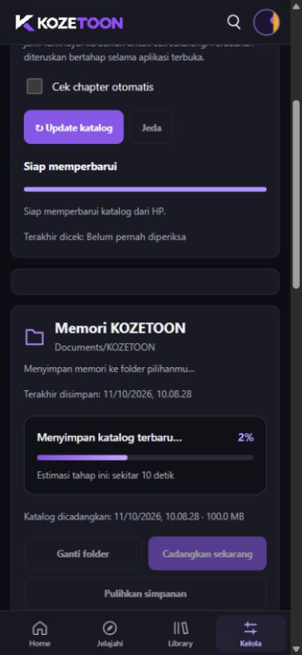
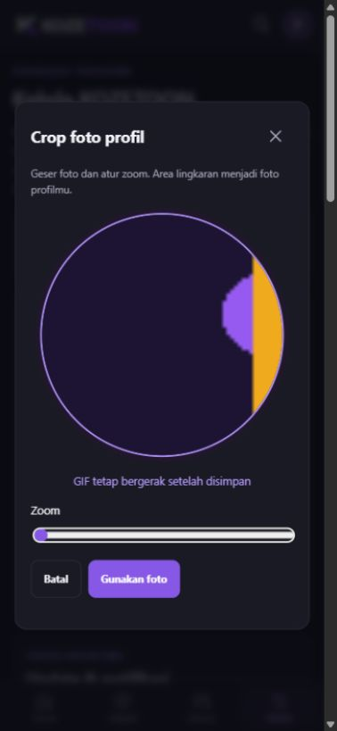
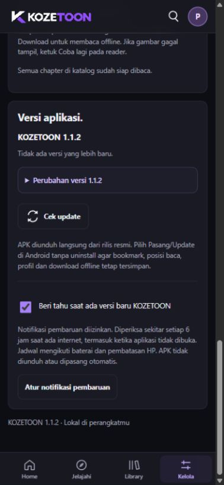

# KOZETOON 1.1.2

<!-- kozetoon-build:25 -->

Rilis stabil pengganti **1.1.2**, 12 Oktober 2026. Versi ini memakai kembali dasar
**1.1.1**, dengan progres backup, foto profil GIF yang bisa di-crop, dan notifikasi versi baru.
Android 7.0 ke atas, ARM64; x86_64 tersedia untuk emulator. Kode sumber tetap private.

**[Unduh APK terbaru](https://github.com/AtillaKuncoroDjati/kozetoon-releases/releases/download/v1.1.2/KOZETOON-1.1.2-local.apk)**

## Perubahan versi ini

- **Kembali ke dasar 1.1.1.** Perubahan reader, Lanjut baca, folder Library dan
  tampilan kesehatan backup pada 1.1.2 sebelumnya dibatalkan. Bookmark, riwayat,
  posisi baca, profil, pengaturan dan download yang sudah ada dipertahankan.
  File backup dari 1.1.2 sebelumnya tetap bisa dibaca; data folder yang sudah
  tersimpan tetap dipertahankan dalam backup, meskipun pengelolaan folder tidak
  ditampilkan pada versi pengganti ini.
- **Garis progres backup.** Saat memilih Cadangkan sekarang, tampil tahap proses,
  persentase dan estimasi waktu untuk tahap tersebut. Persentase dihitung dari
  jumlah catatan atau byte yang benar-benar diproses. Saat jumlah pekerjaan belum
  diketahui, indikator bergerak dan menampilkan Menghitung estimasi. Setiap tahap
  memiliki progres sendiri, jadi persentasenya dapat mulai kembali saat masuk
  tahap berikutnya. **100%** ditampilkan setelah seluruh salinan selesai diperiksa.
  Kegagalan tetap diberi keterangan dan tidak ditampilkan sebagai backup selesai.
- **Profil GIF bergerak dan crop.** Pilih GIF, geser posisi dan atur zoom, lalu
  Gunakan foto dan Simpan profil. GIF tetap bergerak pada profil dan top bar;
  urutan frame, durasi dan pengulangan aslinya dipertahankan. Foto JPG, PNG dan
  WebP masih dapat digunakan. Profil GIF ikut backup lokal.
- **Notifikasi versi baru KOZETOON.** Pemeriksaan rilis berjalan di latar belakang
  sekitar setiap 6 jam saat ada internet dan baterai tidak rendah. Notifikasi juga
  mengenali penyempurnaan dengan nomor versi yang sama. Ketuk **Lihat update** untuk
  menuju panel pembaruan di aplikasi, membaca catatan perubahan dan mengunduh APK.
  Setiap rilis hanya diberitahukan satu kali; menutup notifikasinya tidak menyebabkan
  pemberitahuan yang sama muncul berulang. Notifikasi chapter tetap diatur terpisah.
  Nada bawaan Level Up mengikuti pilihan hening, volume dan pengaturan HP.
- **Update melalui aplikasi.** Pengguna 1.1.2 yang sebelumnya tetap bisa menerima
  APK pengganti dari Cek update. Nomor versi yang terlihat tetap **1.1.2**.
  Pilih Update/Pasang, tanpa uninstall terlebih dahulu.

## Pemasangan dan update

1. Buka **Kelola → Versi aplikasi → Cek update**.
2. Pilih **Unduh update**, tunggu pemeriksaan APK selesai, lalu **Pasang update**.
3. Jika diminta Android, izinkan KOZETOON memasang pembaruan dari sumber ini.
4. Pilih **Update/Pasang**. Bookmark, riwayat, profil dan download dalam aplikasi
   tetap ada apabila package dan sertifikat sesuai serta aplikasi tidak dihapus.

Untuk pengguna 1.0.7 yang updater-nya masih mengarah ke repository lama yang private,
unduh APK di atas dan pasang menimpa aplikasi sekali. Updater versi selanjutnya
menggunakan kanal publik ini. Jangan uninstall atau Hapus data untuk memasang update.

## Mengaktifkan notifikasi versi baru

Buka **Kelola → Versi aplikasi**, aktifkan **Beri tahu saat ada versi baru KOZETOON**.
Jika izin belum aktif, ketuk **Izinkan notifikasi pembaruan** dan setujui dialog Android.
Pengguna yang sudah memberikan izin notifikasi chapter memakai izin aplikasi yang sama;
kategori **Pembaruan aplikasi** memiliki pengaturan tersendiri.

Contoh pemberitahuan: **KOZETOON 1.1.3 sudah tersedia**. Keterangan:
**Ketuk untuk melihat perubahan dan memperbarui aplikasi.** Tombol: **Lihat update**.
Nomor 1.1.3 hanya contoh untuk rilis mendatang, bukan rilis saat ini.

Pemeriksaan ini mengambil metadata rilis, bukan APK atau chapter. Untuk memasang,
pilih Unduh update lalu Pasang update sendiri. Jadwal dapat terlambat karena
penghematan baterai, pembatasan Android atau koneksi. Jika aplikasi di-Force stop,
buka kembali agar pekerjaan terjadwal dapat berjalan lagi. Gunakan Cek update
untuk memeriksa sekarang. Pilihan notifikasi versi baru ikut backup lokal.

## Backup lokal dan pemulihan

Buka **Kelola → Memori KOZETOON**, pilih folder Documents di HP. Aplikasi membuat
folder KOZETOON. Setelah terhubung, perubahan pribadi dicadangkan otomatis;
katalog ikut disalin saat berubah dan proses update katalog sudah tidak aktif.
Tombol **Cadangkan sekarang** menyimpan ulang pribadi dan katalog.

Saat mencadangkan, ikuti garis progres dan keterangan tahap. Estimasi mengikuti
kecepatan proses di HP dan penyimpanan pilihan; tahap persiapan/pemeriksaan tertentu
belum mempunyai estimasi. Tunggu **Backup selesai dan sudah diperiksa**, serta
perubahan tanggal **Terakhir disimpan** dan **Katalog dicadangkan**.

File di folder tersebut:

| File | Isi |
| --- | --- |
| kozetoon-memory.json | Bookmark, riwayat/posisi baca, chapter selesai, profil termasuk GIF, dan pengaturan. |
| kozetoon-catalog.jsonl.gz | Katalog terakhir, metadata, daftar chapter dan alamat gambar yang telah dikumpulkan. |
| File previous | Salinan valid sebelumnya, bila tersedia. |

File di Documents berada di luar data aplikasi dan tetap ada setelah uninstall
atau Hapus data, selama folder/file itu tidak dihapus. Setelah install ulang,
pilih folder yang sama untuk memberikan akses Android lagi. Jika simpanan pribadi
HP masih kosong, backup dipulihkan otomatis. Jika sudah ada simpanan, gunakan
**Pulihkan dan gabungkan**; riwayat HP yang lebih baru dipertahankan.

Chapter yang terbit sesudah tanggal backup diperiksa melalui internet. Tidak perlu
mengumpulkan ulang katalog yang sudah ada dalam salinan valid. Backup JSON lama
saja tidak menyimpan seluruh katalog; cadangkan kembali sebelum uninstall.
**Gambar offline tidak termasuk backup** dan perlu diunduh ulang setelah uninstall.
File backup lokal tidak dienkripsi. Simpan folder di lokasi pribadi.

## Mengubah profil dan memakai GIF

1. Ketuk foto profil di top bar, atau **Kelola → Profil pembaca → Ubah foto dan nama**.
2. Pilih foto atau GIF dari HP.
3. Geser gambar di area crop dan atur Zoom. Animasi GIF terlihat saat mengatur crop.
4. Ketuk **Gunakan foto**. Untuk GIF, tunggu proses animasinya selesai.
5. Isi nama, lalu **Simpan profil**.

GIF sumber dibatasi 8 MB, sisi maksimal 1600 piksel, luas maksimal dua juta piksel,
180 frame dan total piksel frame yang dibatasi untuk menjaga pemakaian memori.
Hasil crop berukuran 256 × 256, maksimal 750 KB. Jika GIF terlalu besar/rumit,
pilih GIF yang lebih pendek atau sederhana. Aplikasi memberi keterangan; GIF
besar tidak diam-diam diubah menjadi foto statis. Foto biasa maksimal 16 MB dan
hasilnya disimpan sebagai JPG berukuran 384 × 384.

## Fitur yang tetap tersedia

| Bagian | Kemampuan |
| --- | --- |
| Home | Cerita pilihan dengan swipe mulus dan pergantian otomatis setiap 5 detik; Lanjut baca, Update terbaru dan rekomendasi geser. |
| Update terbaru | Manga/Manhwa/Manhua langsung di Home, grid/daftar dan tiga chapter terakhir beserta waktu rilis. |
| Jelajahi | Pencarian langsung, filter jenis dan beberapa genre, grid/daftar. |
| Reader | Kontrol minimalis, ketuk tampil/sembunyi, fullscreen, posisi baca, auto-scroll dan tombol Coba lagi. |
| Library | Bookmark, pencarian/filter, riwayat/progres baca dan penanda chapter baru yang berkurang setelah dibaca. |
| Offline | Download chapter secara manual, baca tanpa internet dan pengelolaan penyimpanan maksimal 1 GB. |
| Katalog | Pemeriksaan otomatis saat dibuka, maksimal sekali tiap 6 jam; tarik untuk refresh, update manual dan jeda. |
| Favorit | Pemeriksaan bookmark di latar belakang sekitar tiap jam, notifikasi dengan poster dan nada Level Up. |
| Pembuka | Sembilan poster lokal bergerak di belakang logo yang diam; tidak memerlukan internet. |
| Pemeliharaan | Clear cache, pengaturan pembaca, keamanan tautan, backup pribadi/katalog dan updater APK. |

Notifikasi mengikuti izin, mode hening, volume dan penghematan baterai Android.
Ketuk badan notifikasi untuk detail cerita; **Baca sekarang** menuju chapter.
Tidak ada download chapter otomatis atau backup Google Drive/login Google.

## Tampilan

Preview UI di PC; contoh perpindahan file untuk gambar progres disimulasikan.
Proses native Android perlu diuji pada HP pengguna.

## Informasi APK dan pengujian

- Ukuran: 137019207 byte, sekitar 130.7 MiB. Katalog awal: 1.572 cerita / 149.626 chapter.
- Package: id.kozetoon.local. Sertifikat sama dengan versi sebelumnya.
- SHA-256: `5d7ae9f5a74af33d4f739bcf6ff9d48c1c640e5c7d47d6ffb10afc3859d67ac5`.
- Pengujian backup/GIF, migrasi data dan updater dijalankan di PC. GIF hasil crop
  diperiksa dengan decoder terpisah, termasuk durasi, pengulangan dan disposal frame.
- UI diuji pada 320 × 568 dan 393 × 851. APK, seed, audio, sembilan poster dan
  kesesuaian aset UI diperiksa. Belum diuji pada HP fisik/emulator Android.

APK dan checksum adalah dua aset unduhan yang dikelola. Source code zip/tar.gz
merupakan arsip otomatis GitHub untuk repository distribusi ini, bukan APK dan
bukan kode sumber aplikasi private.
